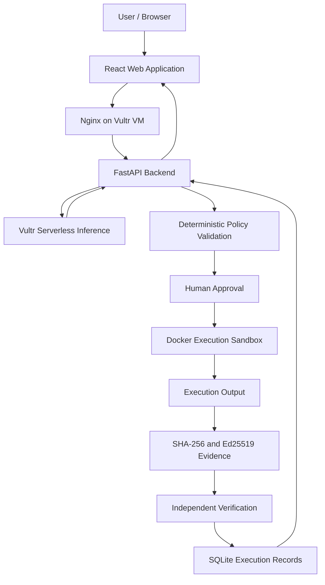

# PINNOTO
### Containment-First AI Execution Platform

**AI should propose. Policies should authorize. Sandboxes should execute. Evidence should prove.**

PINNOTO is an AI-assisted execution platform built for the **Vultr Agent Rush Hackathon — Challenge 1: Blast Radius Zero**.

AI agents can propose actions, but executing unsafe commands, accessing unauthorized resources, or making unexpected changes can create serious security risks. PINNOTO addresses this problem by combining AI planning, deterministic authorization, human approval, isolated Docker execution, and cryptographically verifiable evidence.

## Live Application

- **Application:** http://45.76.111.249:8080/
- **GitHub:** https://github.com/AbhiRamDathu/Pinnoto
- **Backend:** FastAPI running on Vultr Cloud Compute.
- **Inference:** Vultr Serverless Inference.
- **Deployment:** Vultr VM with Docker and Nginx.

## 1. How PINNOTO Works

PINNOTO transforms an AI-generated plan into a controlled execution workflow.

1. **Task submission:** The user submits a task through the web application.
2. **AI planning:** Vultr Serverless Inference generates a bounded execution plan.
3. **Policy validation:** Deterministic authorization checks validate the proposed actions.
4. **Human approval:** The user explicitly approves the proposed plan.
5. **Sandbox execution:** Approved operations execute inside Docker containers.
6. **Evidence generation:** SHA-256 hashes and Ed25519 signatures establish evidence integrity.
7. **Independent verification:** Evidence is checked against a trusted public key.
8. **Persistence:** Execution records are stored in SQLite for inspection and auditing.

Execution is not started merely because the model proposes a plan.

## 2. Vultr Infrastructure and Integration

Vultr is the central infrastructure powering PINNOTO.

### Vultr Cloud Compute

A Vultr Cloud Compute VM hosts the application backend and Docker execution infrastructure.

The VM runs:
- FastAPI backend.
- Docker Engine.
- Execution orchestration.
- Persistent SQLite storage.
- Application networking.

### Vultr Serverless Inference

PINNOTO integrates Vultr Serverless Inference through its OpenAI-compatible inference API.

**Model:** DeepSeek V4.1 Flash.

Inference powers the AI planning workflow. The application sends task information to the inference service and receives a proposed execution plan for subsequent deterministic validation.

Inference credentials remain in the backend configuration and are not intentionally exposed to the frontend or execution container.

### Web Application Deployment

The frontend is built using React and Vite and served through Nginx.

The backend runs separately in a Docker container. Nginx provides the public web entry point and forwards API requests to the backend over the Docker network.

The public application is accessible through the Vultr VM.

## 3. Architecture



**Infrastructure boundary:** The application and Docker execution infrastructure run on the Vultr VM. Docker containers provide process-level isolation; they are not separate virtual machines. The backend controls Docker through its Docker socket, which is a highly privileged host interface and remains part of the trusted control plane.

## 4. Security and Containment

PINNOTO uses multiple execution restrictions to reduce the potential impact of untrusted workloads.

- Docker container isolation.
- Disabled container networking.
- Read-only root filesystem.
- Dropped Linux capabilities.
- Non-root container execution.
- CPU, memory and process-count limits.
- Execution timeouts.
- Bounded execution output.
- Container cleanup after execution.

These restrictions are designed to limit execution capabilities and prevent unauthorized operations from affecting the host.

They reduce attack surface but do not establish immunity against every container escape or host compromise.

## 5. Cryptographically Verifiable Evidence

Every successful execution can produce an evidence record containing:

- Execution ID and timestamp.
- Container image and execution status.
- Exit code.
- SHA-256 output hash.
- Ed25519 signature.
- Trusted public-key verification result.

SHA-256 provides output integrity checking.

Ed25519 provides cryptographic authentication of signed evidence.

Independent verification checks the evidence against the configured trusted public key rather than accepting an arbitrary key supplied by the evidence itself.

Verified records are persisted in SQLite.

## 6. Real Execution Demonstration

The deployed application has successfully completed a real predefined Docker smoke test.

**Verified execution result:**

- Output: `PROOFRUN_SMOKE_OK`
- Exit code: `0`
- Container image: `alpine:3.22`
- Image pinned by SHA-256 digest.
- Evidence hash algorithm: SHA-256.
- Signature algorithm: Ed25519.
- Verification backend: Verified.

This demonstrates an actual execution and evidence-verification workflow rather than a simulated success response.

The application also provides a predefined containment-test workflow. Individual adversarial containment results should be reported only after their execution and verification.

## 7. Technology Stack

| Component | Technology |
|---|---|
| Cloud infrastructure | Vultr Cloud Compute |
| AI inference | Vultr Serverless Inference |
| AI model | DeepSeek V4.1 Flash |
| Backend | Python 3.12, FastAPI |
| Validation | Pydantic |
| Frontend | React 19, JavaScript |
| Frontend tooling | Vite |
| Web server | Nginx |
| Execution isolation | Docker Engine |
| Persistence | SQLite |
| Integrity | SHA-256 |
| Digital signatures | Ed25519 |
| Testing | Pytest |
| API testing | HTTPX |

## 8. Automated Testing

PINNOTO has reached the following reported automated test checkpoint:

**123 tests passed.**

The test coverage includes execution workflows, API behavior, authorization, storage, Docker configuration, security middleware, and evidence verification.

Run the test suite locally:

```powershell
python -m pytest -q
```

A passing automated test suite does not independently establish production readiness or guarantee that all security restrictions resist real-world attacks.

## 9. API Endpoints

| Method | Endpoint | Purpose |
|---|---|---|
| GET | `/health` | Backend health |
| GET | `/api/health/docker` | Docker availability |
| POST | `/api/agent/plan` | Generate execution plan |
| POST | `/api/execution/run` | Execute predefined smoke test |
| GET | `/api/execution/` | Retrieve execution history |

Interactive API documentation is available at:

`http://45.76.111.249:8080/docs`

## 10. Local Development

### Prerequisites

- Python 3.12
- Docker Engine or Docker Desktop
- Git
- PowerShell or an equivalent terminal

### Clone the repository

```powershell
git clone https://github.com/AbhiRamDathu/Pinnoto.git
cd Pinnoto
```

### Create a virtual environment

```powershell
python -m venv .venv
.venv\Scripts\Activate.ps1
```

### Install dependencies

```powershell
python -m pip install -r requirements.txt
```

### Configure environment

Configure the required Vultr inference credentials and application settings using environment variables.

Never commit `.env` files, private signing keys, inference API keys, or other credentials.

### Run the backend

```powershell
python -m uvicorn app.main:app --host 127.0.0.1 --port 8000
```

### Run tests

```powershell
python -m pytest -q
```

Docker must be accessible to the backend for real container execution.

## 11. Security Limitations

PINNOTO is an actively developed hackathon prototype.

Important boundaries:

- Docker socket access is highly privileged.
- Container isolation does not guarantee protection against every kernel or runtime vulnerability.
- A valid signature proves the authenticity of signed data, not the truth of every execution claim.
- The public execution API supports its explicitly authorized operations; internal Python runner functionality should not be confused with unrestricted public code execution.
- Production deployments require additional authentication, HTTPS, rate limiting, monitoring, secret management, and operational hardening.

## 12. Challenge 1 Alignment

PINNOTO addresses the central objective of **Blast Radius Zero**:

- Real AI-assisted task planning.
- Vultr-powered inference.
- Deterministic execution authorization.
- Explicit human approval.
- Isolated Docker execution on Vultr.
- Resource and network restrictions.
- Cryptographically verifiable execution evidence.
- Persistent execution records.

Our objective is to make agent execution controlled, auditable, and independently verifiable.

## 13. Project Information

**Project:** PINNOTO  
**Hackathon:** Vultr Agent Rush Hackathon  
**Challenge:** Challenge 1 — Blast Radius Zero  
**Repository:** https://github.com/AbhiRamDathu/Pinnoto  
**Live Application:** http://45.76.111.249:8080/

**Demo video:** To be added after recording.

---

**PINNOTO — Execute. Contain. Verify.**
